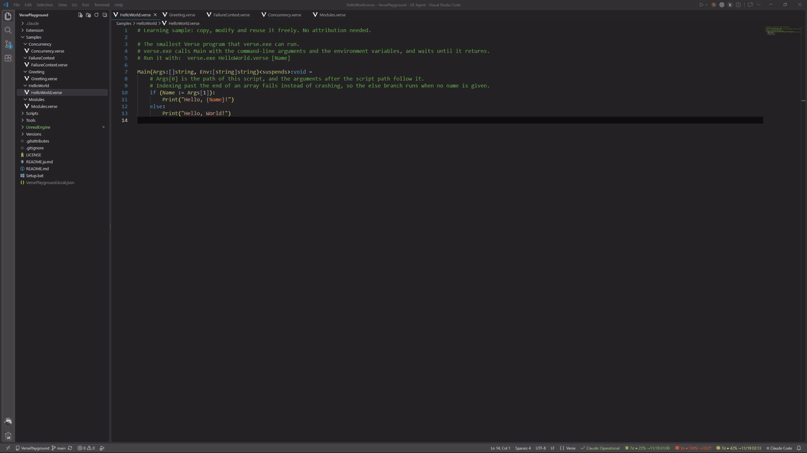

# VersePlayground

[English](README.md) | 日本語

Unreal Engine 6 の Verse を、UEFN やエンジンのフルビルドなしに試すための環境です。

`Setup.bat` を実行すると、Unreal Engine のリポジトリから Verse の実行に必要な部分だけを取得し、
Verse のコマンドラインツール `verse.exe` をビルドします。あとは `.verse` ファイルを 1 つ書けば、その場で実行して動作を確かめられます。

このリポジトリには、`Patches/` のエンジンパッチに含まれる変更箇所の前後数行を除き、Epic Games のコードもバイナリも
含まれていません。エンジンのソースは、Setup が利用者自身のアクセス権で Epic Games の GitHub リポジトリから取得します。

[](videos/RunAndDebug.mp4)

## 必要なもの

| 項目 | 内容 |
|---|---|
| Unreal Engine のソースへのアクセス権 | GitHub アカウントを Epic Games アカウントに連携し、`EpicGames/UnrealEngine` を見られる状態にしておく（[手順](https://www.unrealengine.com/ue-on-github)） |
| Git for Windows | 2.27 以降 |
| Visual Studio | Visual Studio 2026 または Visual Studio 2026 Build Tools と、エンジンが求める MSVC ツールチェーン（現在のバージョンでは v14.50 の 14.50.35723 以降）。コンパイルにはエンジン同梱の Clang を使い、MSVC はライブラリとして使う。それより古い Visual Studio はビルドに使われない。無ければ Setup が Visual Studio Installer での追加を提案する |
| Windows SDK | エンジンが求める版（現在のバージョンでは 10.0.26100.0 以降）。無ければ Setup が Visual Studio Installer での追加を提案する |
| ディスク | 約 10 GB（取得・展開したファイル約 5 GB、ビルドの中間ファイル約 2.5 GB、ダウンロードのキャッシュ約 1 GB） |
| メモリ | 16 GB 以上を推奨。並列コンパイル数はメモリ量から自動で決める |

取得するデータは、git が約 230 MB、バイナリ依存が約 1 GB です（エンジンを丸ごと取得すると数十 GB になります）。

## 使い方

1. このリポジトリを clone する。
2. `Setup.bat` をダブルクリックする。
3. バージョンを選ぶ。Enter で、動作確認済みの最新版が選ばれる。
   そのバージョンが必要とする Windows SDK や MSVC ツールチェーンが無い場合は、ダウンロードの前に知らせ、インストールするかを尋ねる。
   Visual Studio 2026 があればそこへ追加し、無ければ既存の Visual Studio とは別に Visual Studio 2026 Build Tools を入れる。
   インストール時は管理者権限を求められ、Visual Studio は閉じておく必要がある。
   `-InstallBuildTools Yes` / `-InstallBuildTools No` を付けると質問せずに決める。
4. そのバージョンに使える任意のエンジンパッチが `Patches/` にあれば、どれを当てるかを尋ねられる（[エンジンパッチ](#エンジンパッチ)を参照）。
   `-Patches <名前>` / `-Patches none` を付けると質問せずに決める。
5. 初回は GitHub へのサインインを求められるので、Unreal Engine のリポジトリにアクセスできるアカウントでサインインする。
6. エンジンパッチを当てて `verse.exe` をビルドし、`Samples/HelloWorld/HelloWorld.verse` を実行して `Hello, World!` と表示する。
7. VS Code が入っていれば、Verse Playground 拡張を入れるかを尋ねられる（[VS Code](#vs-code) を参照）。
   `-InstallExtension Yes` / `-InstallExtension No` を付けると質問せずに決める。

エンジンは既定で `UnrealEngine/` に置かれます。別の場所にするときは `-InstallDir` を指定します。

```bat
Setup.bat -InstallDir D:\VerseEngine
```

もう一度 `Setup.bat` を実行すると、同じフォルダを選んだバージョンに切り替えてビルドし直します。

## Verse を実行する

```bat
UnrealEngine\Engine\Binaries\Win64\verse.exe Samples\HelloWorld\HelloWorld.verse
UnrealEngine\Engine\Binaries\Win64\verse.exe Samples\HelloWorld\HelloWorld.verse Verse
```

`verse.exe` はファイル内の `Main` を呼び出します。スクリプトのパスより後ろの引数は `Args` に渡されます。

```verse
Main(Args:[]string, Env:[string]string)<suspends>:void =
    Print("Hello, World!")
```

コンパイルエラーは `ファイル(行,列,行,列): Verse compiler error V3506: ...` の形式で表示されます。

### サンプル

サンプルは 1 フォルダに 1 プログラムずつ入っています。自分のコードも 1 フォルダ 1 プログラムにしてください。
VS Code の言語サーバーはフォルダ内のファイルをまとめてチェックするため、同じフォルダに `Main` が 2 つあると衝突します。

| ファイル | 内容 |
|---|---|
| `Samples/HelloWorld/HelloWorld.verse` | 最小のプログラムと、コマンドライン引数の受け取り |
| `Samples/Greeting/Greeting.verse` | `InputLine` で標準入力から名前を読み、あいさつする |
| `Samples/FailureContext/FailureContext.verse` | 失敗しうる式と Failure Context、`<decides>` の関数 |
| `Samples/Concurrency/Concurrency.verse` | `race` と `sync` による構造化並行処理 |
| `Samples/Modules/Modules.verse` | モジュール、アクセス指定子、抽象クラスと継承、エフェクト |
| `Samples/Random/Random.verse` | struct、class、`<constructor>` 関数、失敗しうるメソッドで作る乱数生成器。引数でシードを渡すと別の数列になる |
| `Samples/Timers/Timers.verse` | `Sleep` で待つこと、`race` で作るタイムアウト、並んで待つタスク、`spawn` で始めるタスク |

### 使える機能と制限

- 使えるのは `/Verse.org/Verse` の標準ライブラリと、`verse.exe` が用意する入出力の関数です。
  - `Print`、`InputLine`（標準入力）、`LoadTextFile` / `SaveTextFile`、`Yield`、`Exit`
- `/Verse.org/Simulation` の `Sleep` と `GetSimulationElapsedTime` は、`using { /Verse.org/Simulation }` で使えます
  （エンジンパッチ `verse-simulation-sleep`）。`GetSimulationElapsedTime` はスクリプトを始めてからの秒数です。これと
  `GetSecondsSinceEpoch` は、UEFN で 1 フレームの間は変わらないのと同じように、スクリプトが中断するまで同じ値のままです。
  `Sleep` と `GetSimulationElapsedTime` の時計は、スクリプトが中断せずに動いている間は 0.25 秒までしか進みません。そのため、
  ブレークポイントで止めても、ほかのタスクが再開と同時にまとめて動き出すことはありません。0.25 秒より長くかかる計算も
  0.25 秒として数えます。
- Fortnite や UEFN の API（`/Fortnite.com/...`、`/UnrealEngine.com/...`）はありません。`@editable` を使うと実行時エラーで
  止まります。UEFN のチュートリアルのコードは、そのままでは動かないことがあります。
- `verse.exe` には別のフォルダのモジュールを読み込むオプション `--mount` がありますが、まだ実装されていません。モジュールは `Main` と同じファイルの中に定義します。

## VS Code

`Extension/verse-playground.vsix` は、この環境用の VS Code 拡張です。Setup が導入を尋ねるほか、VS Code の
「Extensions: Install from VSIX...」から自分で入れることもできます。このリポジトリのフォルダ（またはその下のフォルダ）を
開けば、拡張が `verse.exe` を自動で見つけます。

| 機能 | 内容 |
|---|---|
| 実行 | エディタ右上の ▶ ボタンか Ctrl+F5 で、開いているファイルをターミナルで実行する（`InputLine` も使える）。キーは「キーボード ショートカット」（Ctrl+K Ctrl+S）で「Verse: Run Verse File」を検索して変えられる |
| 引数 | Ctrl+Shift+F5（「Verse: Run Verse File with Arguments...」）か Shift+F5（「Verse: Debug Verse File with Arguments...」）で、`Args` に渡す引数を入力する。使った引数は `.verse` ごとに記録され、上下キーで新しい順に選べる |
| デバッグ | その隣のボタンか F5。ブレークポイント、ステップオーバー / イン / アウト、コールスタック、「変数」ビューでのローカル変数。Verse の関数を呼ぶ行のブレークポイントは、呼び出しから戻ったときにもう一度止まる |
| 構文ハイライト | 拡張の初回起動時に、自分のエンジンのチェックアウトからコピーする。ウィンドウの再読み込みを求められたら従う |
| エラー表示 | 実行したときのコンパイルエラーを Problems パネルに表示する |
| 入力中のエラー、ホバー、定義へ移動、補完 | Verse の言語サーバーが必要（下記） |

言語サーバーは、このリポジトリにも Unreal Engine のソースにも含まれていません。UEFN が VS Code に入れる Verse 拡張
（`epicgames.verse`。VS Code Marketplace には公開されていない）に同梱されています。UEFN を入れていれば、Verse Playground は
そのサーバーを、自分のエンジンのチェックアウトの Verse で動かします。このとき UEFN の Verse 拡張はワークスペースで無効に
してください。有効なままだとサーバーが 2 つ動き、すべてのエラーが 2 回表示されます（有効なときは Verse Playground が知らせます）。
UEFN が無くても、表のそれ以外の機能は使えます。

## バージョンの管理

`Versions/` には、エンジンのコミットごとに、取得するディレクトリの一覧とバイナリ依存の一覧が入っています。

| ファイル | 内容 |
|---|---|
| `sparse-paths.txt` | git の sparse checkout で取得するディレクトリ |
| `gitdepsignore.txt` | エンジンの `GitDependencies` が取得するバイナリ依存のホワイトリスト。Setup が `.gitdepsignore` としてコピーする |
| `version.json` | コミット、確認したかどうか、ダウンロード量の見積もり、エンジンが必要とする Windows SDK と MSVC ツールチェーン、そのバージョンに必要なエンジンパッチ（`patches`） |

Setup は確認済み（`"verified": true`）のバージョンを既定にします。確認していないバージョンを選ぶと警告を表示します。
`-Version` にフォルダ名かコミットの先頭部分を渡すと、質問せずにそのバージョンを使います。

### エンジンパッチ

`Patches/` には、エンジンのソースへの小さな修正が、エンジンのチェックアウトで `git diff` を取った `.patch` ファイルとして
1 つずつ入っています。先頭の `Title:` 行と差分より前の文章が、何を直すパッチかの説明です。Setup は取得の後、ビルドの前に
パッチを当てます。

- そのバージョンの `version.json` の `patches` に書かれたパッチは必ず当てます。当たらなければ、そのバージョンに必要だと
  分かっているため Setup を止めます。
- `Patches/` にあるそれ以外のパッチは任意です。Setup が一覧を出して当てるものを尋ね、Enter で前回選んだものを使います。
  `-Patches 名前1,名前2` で質問せずに選び、`-Patches none` で必要なものだけを当てます。そのバージョンに当たらない任意の
  パッチは、警告を出して飛ばします。
- 自分の変更を試すときは、エンジンのチェックアウトを編集してから `git diff > ..\Patches\<名前>.patch` を実行し、先頭に
  `Title:` 行を足して、Setup で選びます。

Setup はパッチを当てたファイルを `VersePlayground.local.json` に記録し、別のバージョンに切り替える前に元へ戻します。
バージョンを切り替えるときも、選ぶパッチを変えるときも、元のファイルから当て直します。

| パッチ | 直すこと |
|---|---|
| `debugger-constructor-self` | `<constructor>` 関数の中や、そこから呼ばれる関数の中で止まると、デバッグ中に `verse.exe` が終了する。エンジンはコンストラクタ関数のために生成するラッパを Self なしで呼び、デバッガはそのフレームを含むコールスタックを作るときにプログラムを止めてしまう |
| `verse-simulation-sleep` | `verse.exe` には `Sleep` が無く、`GetSecondsSinceEpoch` は実行中ずっと起動時の時刻を返す。Epic の VerseSimulation モジュール（`Sleep` と `GetSimulationElapsedTime` を宣言している）を組み込み、ゲームのワールドが無いプログラム用に実装する。時刻はスクリプトが再開するたびに進み、`Sleep` は実時間で待つ。ブレークポイントで止めていた時間は数えない |

#### パッチを公開するときの決まり

パッチの文脈行と削除行は、エンジンのソースそのものです。Unreal Engine EULA の 5(a)(ii) は、30 行までのエンジンのコードの
断片をパッチに付けて配布することを認めていますが、断片を集めてエンジンのより大きな部分を組み立て直すことは認めていません。
そのため、このリポジトリに入れるパッチは次を守ります。

- 1 つのパッチが含むエンジンのコード（各ハンクの文脈行と削除行）は、合計 30 行まで。超えるときは `git diff -U1` で文脈を
  減らす。git が `@@ ... @@` の見出しの後ろに付ける、周りの関数の行も数に入る。`git apply` には要らないので見出しから消す。
- すべてのパッチを合わせても、1 つのエンジンのファイルから含むのは 30 行まで。
- エンジンのファイルを丸ごとコピーしたファイルやバイナリを含めない。パッチを当てた後のファイルをそのままリポジトリに置かない。
  EULA の 5(a)(i) により、エンジンのコードそのものを公開で配布できるのは、Epic の GitHub の fork か Fab を通す場合だけです。

`Tools\Test-EnginePatches.ps1` がこれを検査します。パッチを足したり変えたりしたら、コミットの前に実行します。

```powershell
.\Tools\Test-EnginePatches.ps1
```

自分のパソコンだけで使うパッチには、この制限はありません。Setup は決まりを超えるパッチも当てますが、公開しないよう警告します。

### 新しいエンジンのコミットを追加する（メンテナー向け）

1. エンジンをフルで clone し、エンジンの `Setup.bat` を実行しておく。
2. 一覧を生成する。

   ```powershell
   .\Tools\New-VersionManifest.ps1 -EngineDir 'D:\UnrealEngine'
   ```

   UnrealBuildTool で `VerseCmd` ターゲットのモジュール依存を書き出し、`Tools/ManifestRules.psd1` のルールを足して
   `Versions/<ブランチ>-<コミット>/` を作ります。必要なパッチは、既存の最新バージョンのうち新しいコミットにも当たるものを
   引き継ぎ、当たらなくなったものは警告します。そのパッチを直すか、エンジン側で直っていれば外します。
3. 空のフォルダに Setup して確かめる。

   ```bat
   Setup.bat -Version <フォルダ名> -InstallDir D:\VerseVerify
   ```

4. ビルドとサンプルの実行が通ったら、`version.json` の `verified` を `true`、`verifiedDate` を確認した日付にする。

モジュール依存だけでは足りないファイル（UnrealBuildTool が直接読むもの、同梱のコンパイラなど）は
`Tools/ManifestRules.psd1` に理由と一緒に書いてあります。新しいコミットでビルドが失敗したら、まずここへの追加が必要かを調べます。

### VS Code 拡張をビルドする（メンテナー向け）

拡張のソースは `Extension/` にあります。ビルドには Node.js 22.18 以降が必要です。

```bat
cd Extension
npm ci
npm run package
```

型チェックとテストを実行し、`Extension/verse-playground.vsix` を書き出します。`Extension/package.json` の `version` を
上げ、新しい `.vsix` をコミットします。利用者は Node.js なしで使え、どのビルドが入っているかも見分けられます。

パッケージにせずに変更を試すときは、VS Code で `Extension` フォルダを開いて F5（「Run Extension」）を押します。
拡張をビルドし、インストール済みのものではなくソースの拡張を読み込んだ別ウィンドウ（Extension Development Host）で
リポジトリのルートを開きます。`Extension/src` に置いたブレークポイントで止まります。単体テストだけなら `Extension` で
`npm test` を実行します。

## ライセンス

このリポジトリのスクリプト、ツール、VS Code 拡張は [MIT License](LICENSE) で公開しています。

`Samples/` のプログラムは学習用です。表記を残す必要もなく、自由にコピー・改変・再利用できます。

Setup が取得する Unreal Engine のソースとバイナリは、このリポジトリには含まれません。アクセス権を得るときに同意した
Unreal Engine EULA が引き続き適用されます。`Patches/` のパッチは変更箇所の前後数行のエンジンのソースを
[パッチを公開するときの決まり](#パッチを公開するときの決まり)の範囲で含み、その部分にも Unreal Engine EULA が適用されます。
