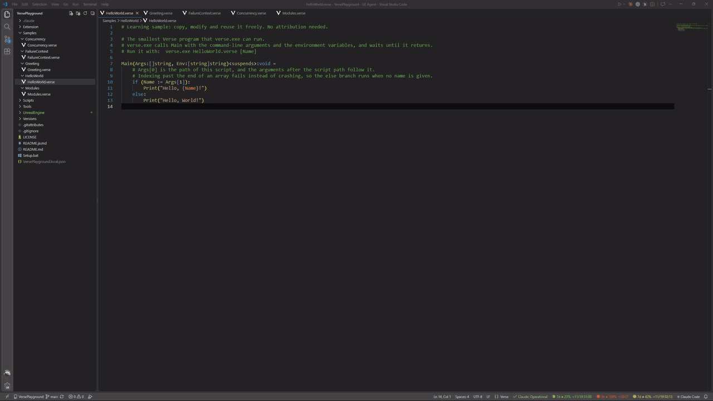

# VersePlayground

English | [日本語](README.ja.md)

A playground for trying Verse in Unreal Engine 6 without UEFN and without building the whole engine.

`Setup.bat` fetches only the parts of the Unreal Engine repository that Verse needs and builds `verse.exe`,
the Verse command-line tool. After that, you can write a single `.verse` file and run it right away to see what it does.

This repository contains no Epic Games code or binaries, apart from the few lines of context around each change in
the engine patches in `Patches/`. Setup fetches the engine source from the Epic Games repository on GitHub with your
own access.

[](videos/RunAndDebug.mp4)

## Requirements

| Item | Details |
|---|---|
| Access to the Unreal Engine source | Link your GitHub account to your Epic Games account so that you can see `EpicGames/UnrealEngine` ([instructions](https://www.unrealengine.com/ue-on-github)) |
| Git for Windows | 2.27 or later |
| Visual Studio | Visual Studio 2026 or Visual Studio 2026 Build Tools with the MSVC toolchain the engine needs (v14.50, 14.50.35723 or later, for the current version). The engine compiles with its bundled Clang and uses the MSVC libraries. Older Visual Studio products are ignored by the build. When it is missing, Setup offers to add it with the Visual Studio Installer |
| Windows SDK | The version the engine needs (10.0.26100.0 or later for the current version). When it is missing, Setup offers to add it with the Visual Studio Installer |
| Disk | About 10 GB (about 5 GB of fetched and extracted files, 2.5 GB of intermediate build files, and 1 GB of download cache) |
| Memory | 16 GB or more is recommended. Setup chooses the number of parallel compile processes from the installed memory |

Setup downloads about 230 MB with git and about 1 GB of binary dependencies. Fetching the whole engine takes tens of GB.

## Usage

1. Clone this repository.
2. Double-click `Setup.bat`.
3. Choose a version. Pressing Enter picks the newest verified version.
   If that version needs a Windows SDK or an MSVC toolchain you do not have, Setup says so before downloading
   anything and offers to install them. It adds them to Visual Studio 2026, or installs Visual Studio 2026 Build
   Tools next to your other Visual Studio products when there is none. Windows asks for administrator permission,
   and Visual Studio must be closed while it installs. `-InstallBuildTools Yes` or `-InstallBuildTools No` answers
   without asking.
4. If `Patches/` has optional engine patches for that version, Setup asks which ones to apply (see
   [Engine patches](#engine-patches)). `-Patches <names>` or `-Patches none` answers without asking.
5. The first time, Git asks you to sign in to GitHub. Sign in with the account that has access to the Unreal Engine
   repository.
6. Setup applies the engine patches, builds `verse.exe`, runs `Samples/HelloWorld/HelloWorld.verse` and prints
   `Hello, World!`.
7. If VS Code is installed, Setup asks whether to install the Verse Playground extension (see [VS Code](#vs-code)).
   `-InstallExtension Yes` or `-InstallExtension No` answers without asking.

The engine goes to `UnrealEngine/` by default. Use `-InstallDir` to put it somewhere else.

```bat
Setup.bat -InstallDir D:\VerseEngine
```

Running `Setup.bat` again switches the same folder to the chosen version and rebuilds it.

## Running Verse

```bat
UnrealEngine\Engine\Binaries\Win64\verse.exe Samples\HelloWorld\HelloWorld.verse
UnrealEngine\Engine\Binaries\Win64\verse.exe Samples\HelloWorld\HelloWorld.verse Verse
```

`verse.exe` compiles every `.verse` file directly in the folder of the file you give it as one program (up to 500
files and 32 MB; subfolders are not included) and calls `Main`. A function written in another file of the same folder
can be used. Arguments after the script path are passed in `Args`. This needs the `verse-ide-analysis` engine patch
(see [Engine patches](#engine-patches)).

```verse
Main(Args:[]string, Env:[string]string)<suspends>:void =
    Print("Hello, World!")
```

Compile errors are printed as `file(line,column,line,column): Verse compiler error V3506: ...`.

### Samples

Each sample is a folder with one program in it. Keep to one program per folder for your own code too: running,
debugging and the VS Code checks all treat the `.verse` files of a folder as one program, so two `Main` functions in
one folder conflict (a "duplicate definition" compile error).

| File | Shows |
|---|---|
| `Samples/HelloWorld/HelloWorld.verse` | The smallest program, and reading command-line arguments |
| `Samples/Greeting/Greeting.verse` | Reading your name from standard input with `InputLine` and greeting you |
| `Samples/FailureContext/FailureContext.verse` | Expressions that can fail, failure contexts, and `<decides>` functions |
| `Samples/Concurrency/Concurrency.verse` | Structured concurrency with `race` and `sync` |
| `Samples/Modules/Modules.verse` | Modules, access specifiers, abstract classes and inheritance, and effects |
| `Samples/Random/Random.verse` | A random number generator built from a struct, a class, a `<constructor>` function and a failable method. Pass a seed as an argument to get other numbers |
| `Samples/Timers/Timers.verse` | Waiting with `Sleep`, a timeout made with `race`, tasks that wait side by side, and a task started with `spawn` |

### What is available

- You can use the `/Verse.org/Verse` standard library and the input/output functions that `verse.exe` provides.
  - `Print`, `InputLine` (standard input), `LoadTextFile` / `SaveTextFile`, `Yield`, `Exit`
- `Sleep` and `GetSimulationElapsedTime` of `/Verse.org/Simulation` work with `using { /Verse.org/Simulation }`
  (the `verse-simulation-sleep` engine patch). `GetSimulationElapsedTime` counts the seconds since the script
  started, and it and `GetSecondsSinceEpoch` stay the same until the script suspends, as they do within one frame
  in UEFN. The clock of `Sleep` and `GetSimulationElapsedTime` advances by at most 0.25 seconds while the script
  runs without suspending, so stopping at a breakpoint does not make the other tasks wake up at once. A computation
  that takes longer than that counts as 0.25 seconds as well.
- Fortnite and UEFN APIs (`/Fortnite.com/...`, `/UnrealEngine.com/...`) are not available, and `@editable` stops the
  script with a runtime error. Code from UEFN tutorials may not run as is.
- `verse.exe` has a `--mount` option for loading modules from other folders, but it is not implemented yet.
  Put the code in the folder of `Main` instead: every `.verse` file in that folder is compiled together, and a module
  can be defined in any of them.

## VS Code

`Extension/verse-playground.vsix` is a VS Code extension for this playground. Setup offers to install it, or install
it yourself with "Extensions: Install from VSIX..." in VS Code. Open this repository's folder (or any folder below it)
and the extension finds `verse.exe` by itself.

| Feature | Details |
|---|---|
| Run | The ▶ button in the editor title, or Ctrl+F5, runs the folder of the open file as one program in a terminal, so `InputLine` works. Unsaved `.verse` files of the folder are saved first; if one cannot be saved, the run is cancelled. To change the key, search for "Verse: Run Verse File" in Keyboard Shortcuts (Ctrl+K Ctrl+S) |
| Arguments | Ctrl+Shift+F5 ("Verse: Run Verse File with Arguments...") or Shift+F5 ("Verse: Debug Verse File with Arguments...") asks for the arguments passed in `Args`. Each `.verse` file remembers the arguments used with it; pick one with the up and down keys, newest first |
| Debug | The button next to it, or F5. Breakpoints, step over / into / out, the call stack, and local variables in the Variables view. A breakpoint on a line that calls a Verse function stops again when the call returns. The whole folder is the program, so a breakpoint in another file of the folder stops too |
| Syntax highlighting | Copied from your engine checkout the first time the extension starts, after you allow that engine (see below). Reload the window when it asks |
| Errors while typing | Errors and warnings of every `.verse` file in the folder appear in the Problems panel as soon as you open a file, and follow your edits without saving. They come from the `verse.exe` that runs the folder, so they match the compile errors of a run |
| Hover, go to definition | Hover shows the signature and type of a definition, and go to definition (F12) opens it, in another file of the folder or in the engine's `.verse` declarations. Use them on a place that uses a definition, not on the definition itself. While the folder has a syntax error they return nothing; fix it and they come back |
| Completion | Only with the UEFN language server (see below) |

#### Language server

By default (`versePlayground.languageServer.kind` = `builtin`), Verse Playground analyzes your code with the
`verse.exe` that Setup built, so UEFN is not needed. This needs an engine version with the `verse-ide-analysis` patch
(see [Engine patches](#engine-patches)), which is applied to `ue6-main-f9f48a4bf1b9` and `ue6-main-7dc0dff55638`.
If your `verse.exe` was built before this patch or from another version, the extension says so once; run `Setup.bat`
again with one of those versions, then run "Verse: Restart Language Server" (or reload the window). Files in the engine
checkout and new files that were never saved are not checked. Do not put a `.verse` file directly in a drive root such
as `C:\`; put it in a folder.

To use the language server of UEFN instead, set `versePlayground.languageServer.kind` to `uefn`. That server comes with
the Verse extension (`epicgames.verse`) that UEFN installs into VS Code, which is not on the VS Code Marketplace. It is
not part of this repository or of the Unreal Engine source. It runs with the Verse version of your engine checkout,
gives completion as well, and `versePlayground.languageServer.path` can point to its `verse-lsp.exe`. A path you set
before is used only after you choose `uefn`.

Whichever you choose, disable the UEFN Verse extension for the workspace: when it is enabled, Verse Playground does
not start its own server, because both servers would run and every error would be shown twice. Verse Playground tells
you when it is enabled. `versePlayground.languageServer.enabled` turns the language server off; the compile errors of
a run still appear in the Problems panel.

#### Allowing an engine to run

The built-in analysis starts the engine's `verse.exe`. It does so without asking for an engine you set in your user
settings, and for the engine that Setup created for a workspace you trust. For any other engine (a file opened
without a folder, a file outside the workspace, or an engine named in the workspace settings) a notification asks
once whether that `verse.exe` may run. "Allow" is remembered; "Don't allow" (or closing the notification) stops the
checks of those folders in that window. "Verse: Restart Language Server" asks again, and "Verse: Forget Allowed
Engines" clears everything you allowed. Running and debugging are not affected. In a workspace you have not trusted
(Restricted Mode), the language server does not start.

## Versions

`Versions/` holds, for each engine commit, the list of directories to fetch and the list of binary dependencies.

| File | Contents |
|---|---|
| `sparse-paths.txt` | Directories that git fetches with sparse checkout |
| `gitdepsignore.txt` | Whitelist of binary dependencies for the engine's `GitDependencies`. Setup copies it to `.gitdepsignore` |
| `version.json` | The commit, whether it has been verified, the estimated download size, the Windows SDK and MSVC toolchain the engine needs, and the engine patches it needs (`patches`) |

Setup defaults to a verified version (`"verified": true`) and warns when you choose one that has not been verified.
Pass a folder name or the start of a commit hash to `-Version` to use that version without being asked.

### Engine patches

`Patches/` holds small fixes to the engine source, one `.patch` file each, made with `git diff` in the engine
checkout. The `Title:` line and the text above the diff explain what the patch fixes. Setup applies them after
fetching and before building.

- The patches listed in `patches` of the version's `version.json` are always applied. If one does not apply, Setup
  stops, because that version is known to need it.
- Every other patch in `Patches/` is optional. Setup lists them and asks which to apply; Enter keeps the ones chosen
  last time. `-Patches name1,name2` chooses without asking, and `-Patches none` applies only the needed ones. An
  optional patch that does not apply to the version is skipped with a warning.
- To try a change of your own, run `git diff > ..\Patches\<name>.patch` in the engine checkout after editing it,
  add a `Title:` line at the top, and choose it in Setup.

Setup remembers which files it patched in `VersePlayground.local.json` and restores them before it switches the
checkout to another version, so switching versions and choosing other patches both start from the original files.

| Patch | Fixes |
|---|---|
| `debugger-constructor-self` | Debugging ends `verse.exe` when it stops inside a `<constructor>` function, or in a function that one calls. The engine calls the wrapper it generates for a constructor function without a Self, and the debugger stops the program when it lists a call stack with such a frame |
| `verse-simulation-sleep` | `verse.exe` has no `Sleep`, and `GetSecondsSinceEpoch` returns the start time for the whole run. It links Epic's VerseSimulation module, which declares `Sleep` and `GetSimulationElapsedTime`, and implements them for a program without a game world: the clock advances each time the script resumes, and `Sleep` waits in real time, without counting the time stopped at a breakpoint |
| `verse-ide-analysis` | `verse.exe` compiles only the file it runs, so a function in another file of the same folder cannot be called, and an editor cannot check Verse code with the compiler that runs it. It makes `verse.exe` compile every `.verse` file directly in the folder as one program (up to 500 files and 32 MB), and adds `--ide-request`, which answers one editor request on stdin and stdout: the diagnostics of a folder, or the hover text or the definition at a position. It links Epic's VerseAssist module. Applies to `ue6-main-f9f48a4bf1b9` and `ue6-main-7dc0dff55638` |

#### Rules for publishing a patch

The context lines and the removed lines of a patch are engine source. Section 5(a)(ii) of the Unreal Engine EULA
allows distributing snippets of Engine Code of up to 30 lines with a patch, but not putting snippets together into a
larger part of the engine. So the patches in this repository follow these rules:

- A patch quotes at most 30 lines of engine code in total, counting the context lines and the removed lines of every
  hunk. When it quotes more, make the context smaller with `git diff -U1`. The line of the enclosing function that
  git puts after each `@@ ... @@` header counts as well; `git apply` does not need it, so delete it from the header.
- All the patches together quote at most 30 lines of any one engine file.
- A patch does not add a copy of an engine file or change a binary file. Patched files are never put in the
  repository as they are: under section 5(a)(i), Engine Code itself can be distributed publicly only through a fork
  of Epic's GitHub repository or through Fab.

`Tools\Test-EnginePatches.ps1` checks these rules. Run it before committing a new or changed patch.

```powershell
.\Tools\Test-EnginePatches.ps1
```

A patch that you use only on your own computer has no such limit. Setup applies a patch that breaks the rules, but
warns you not to publish it.

### Adding a new engine commit (for maintainers)

1. Clone the full engine and run the engine's `Setup.bat`.
2. Generate the lists.

   ```powershell
   .\Tools\New-VersionManifest.ps1 -EngineDir 'D:\UnrealEngine'
   ```

   This exports the module dependencies of the `VerseCmd` target with UnrealBuildTool, adds the rules in
   `Tools/ManifestRules.psd1`, and creates `Versions/<branch>-<commit>/`. When the commit is checked out as a detached
   HEAD, name its branch with `-Branch ue6-main`. The needed patches start as those of the
   newest existing version that still apply to the new commit; the script warns about the ones that no longer apply.
   Update such a patch, or leave it out when the engine has fixed the problem.
3. Run Setup into an empty folder to check it.

   ```bat
   Setup.bat -Version <folder name> -InstallDir D:\VerseVerify
   ```

4. When the build and the samples succeed, set `verified` to `true` and `verifiedDate` to the date of the check in
   `version.json`.

Files that the module dependencies do not cover, such as files that UnrealBuildTool reads directly and the bundled
compiler, are listed in `Tools/ManifestRules.psd1` together with the reason for each. When a new commit fails to
build, first check whether something needs to be added there.

### Building the VS Code extension (for maintainers)

The extension's source is in `Extension/`. Building it needs Node.js 22.18 or later.

```bat
cd Extension
npm ci
npm run package
```

This type-checks, runs the tests and writes `Extension/verse-playground.vsix`. Raise `version` in
`Extension/package.json` and commit the new `.vsix` so that users need no Node.js and can tell which build they have.

To try a change without packaging, open the `Extension` folder in VS Code and press F5 ("Run Extension"). It builds
the extension and opens the repository root in a second window, the Extension Development Host, that loads the
extension from source instead of the installed one. Breakpoints in `Extension/src` stop there. `npm test` runs only
the unit tests in `Extension/test`.

## License

The scripts, tools and VS Code extension in this repository are released under the [MIT License](LICENSE).

The programs in `Samples/` are for learning. Copy, modify and reuse them freely, without keeping any notice.

The Unreal Engine source and binaries that Setup fetches are not part of this repository. They stay under the Unreal
Engine EULA that you accepted to get access to them. The patches in `Patches/` quote a few lines of the engine source
around each change, within the limit in [Rules for publishing a patch](#rules-for-publishing-a-patch); those lines
stay under the Unreal Engine EULA as well.
